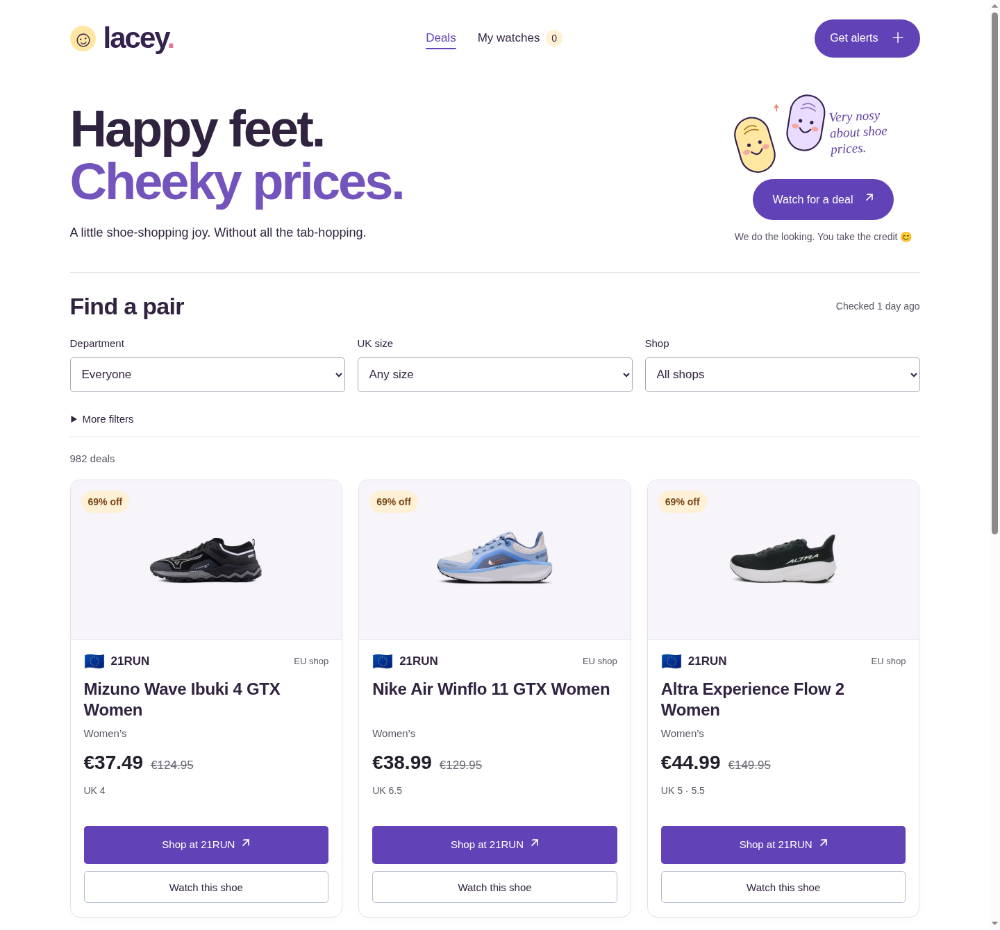
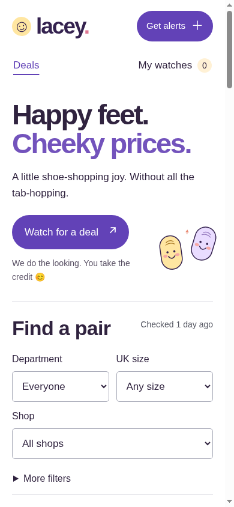
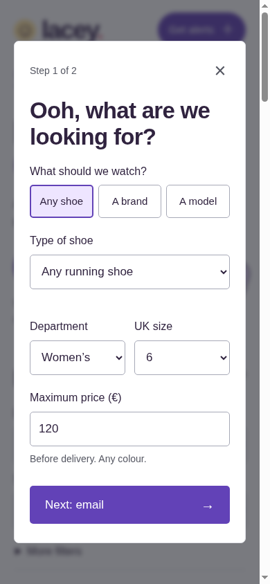

<p align="center">
  
</p>

<h1 align="center">Lacey</h1>
<p align="center"><strong>Happy feet. Cheeky prices.</strong></p>
<p align="center"><a href="https://lacey.january.ie">Meet Lacey ↗</a> · <a href="#try-it-locally">Run locally</a> · <a href="LICENSE">MIT licence</a></p>

A little side project for a running club with a perfectly reasonable **“just one more pair”** problem. 😊

Tell Lacey your size, your budget and the shoes you have a soft spot for. She keeps a nosy eye on Irish and European shops and emails you when a matching deal turns up. Your browser tabs can finally have a rest.

No account to create. No password to remember. Two very cheerful feet.



## A small journey

1. **Pick your size and budget.** Watch a particular model, a brand, or a type of running shoe. Men’s, women’s and kids’ shoes are included.
2. **Confirm your email once.** Add more watches from the same verified browser without another round of confirmation.
3. **Get the good news.** Matching finds arrive together in a compact email, with the shop, price and direct link. Up to two sale emails a day.

Pause a watch or unsubscribe whenever you like. No hard feelings. 😊

<p align="center">
  
  &nbsp;&nbsp;
  
</p>

## A friendly face. A fairly fussy engine.

The smiley faces get the attention. The quiet bits do the work:

- **Collect once, match many times.** A shared catalogue feeds indexed watch matching. More subscribers don’t mean crawling every shop again for every person.
- **Check the actual size.** Retailer size labels, stock, currency and product identity must agree. Ambiguous sizes stay shop-specific; conversions aren’t guessed.
- **Keep one shoe together.** Recognised models can share a card across sizes and shops. Email matching ranks the cheapest verified option for the watched size.
- **Remember what was sent.** Persistent recommendation receipts prevent the same shoe returning in tomorrow’s email under a slightly different shop name.
- **Publish carefully.** Completed snapshots replace the catalogue atomically. Conflicting records are withheld, expired offers disappear, and stock is checked again before email delivery.
- **Make failure visible.** Each shop shows its coverage and actual check time. A blocked shop can sit out while healthy ones keep working.

The scheduled workflow is ordinary, deterministic code. **No LLM runs the price checks, matching or email delivery.**

## Made of

| Part | Choice |
| --- | --- |
| Runtime and tooling | Bun, with pinned versions |
| Application | TypeScript, plain HTML/CSS and a little original SVG artwork |
| Data | SQLite locally; Neon Postgres through native `Bun.SQL` in production |
| Hosting and email | Vercel and Resend |
| Scheduled work | Bun scripts on GitHub Actions, with checkpoints, bounded retries and an email outbox |

The interface is intentionally small: readable text, a few useful decisions, and a bit of warmth. There’s a [design note about giving software a personality](docs/designing-with-personality.md) if that side interests you.

## Try it locally

Install the Bun version in [`package.json`](package.json), then:

```sh
git clone https://github.com/georgesterpu/lacey.git
cd lacey
bun install --frozen-lockfile
cp .env.example .env
bun run dev
```

Open **http://localhost:3000**. Development uses `.data/brave.sqlite`, with local migrations applied automatically. A new database starts empty.

To collect live offers, set `APP_URL=http://localhost:3000` and a random `CRON_SECRET` in your local `.env`, then run `bun run scan`. Retailer access and coverage vary. Email needs your own verified Resend sender and credentials; never use production member data for development.

```sh
bun run check
bun test
bun run build:vercel
```

Browser checks also need a Chrome-family executable. The CI suite uses isolated databases and a fake email provider; it includes a native Postgres integration check.

## Running your own lookout

The public repository contains the application, parsers, tests and [operations templates](operations/README.md). Lacey’s production schedules, credentials, logs and encrypted customer backups live in a separate **private operations repository**.

Production workers use the exact tested revision already deployed to the website. Website releases are staged and checked before promotion, with a public browser check and rollback. Pushing code does not automatically replace the live site.

See the [deployment guide](docs/deployment-handoff.md), [reliability notes](docs/reliable-checks.md), and [retailer connector notes](docs/retailer-connectors.md) for the practical details.

## An honest little beta

Retailers change their pages, retire products and sometimes block collection. An implemented connector doesn’t guarantee live coverage. Lacey reports that per shop and withholds offers it can’t validate. Discounts compare with the retailer’s reference price and exclude delivery; automatic coupon discovery is not implemented.

This is a small, evolving project built for real people in a running club. A reliable shop suggestion, a clearer bit of wording, or a good bug report is very welcome. Open an [issue](https://github.com/georgesterpu/lacey/issues) or send a pull request. Please keep changes focused and run the relevant checks. For security issues, use [private reporting](SECURITY.md).

## Licence

[MIT](LICENSE), © 2026 George Sterpu. Retailer names, product photographs and product data belong to their respective owners; the code licence does not grant rights to those materials.

Made with care, and a mildly suspicious interest in shoe prices. ☺
