# Reliable checks and predictable growth

This is the implemented pipeline and the next scaling plan. The consumer app is called **Lacey** as a working name; no domain or trademark availability is claimed.

```mermaid
flowchart LR
  A[08:00 and 20:00 Dublin\nGitHub Actions] --> B[Collect each shop once]
  B --> C[Validate a separate snapshot]
  C --> D[Publish complete source pointer]
  D --> E[Indexed watch matching]
  E --> F[Fresh product + page checks]
  F --> G[One durable digest per email + slot]
  G --> H[Deliver within budget]
  H --> I[Read back health + source results]
```

## Scheduling without an LLM

`.github/workflows/shoehoo-checks.yml` runs ordinary Node code from `scripts/run-jobs.mjs` in a private GitHub repository. It has no prompt, model, context window, AI SDK, browser agent or per-recipient crawler. The schedule is `0 8,20 * * *` with `Europe/Dublin` as its IANA timezone. `scheduleSlot()` uses the same timezone, including daylight saving transitions. A catch-up trigger at 08:15/20:15 retries a missed primary event; it skips a completed slot. Every scheduled slot has one database run identity. Repeated triggers reuse the run; source failures have at most three attempts and stale run leases can be recovered.

Actions concurrency prevents scheduled/manual jobs overlapping. Each HTTP writer requires the server-only `CRON_SECRET`; browser visitors and the former ChatGPT task cannot trigger the new writer. Workflow variables/secrets are set outside Git. The app remains public and account-free.

GitHub scheduling is **best effort**, not a real-time guarantee: GitHub documents that scheduled events may be delayed or dropped under load. The workflow verifies persisted completion, and `/api/health` exposes actual run state, source results, stale state and outbox counts. The requested times are targets, not a promise that email arrives exactly on the minute. If tighter availability is needed, move this same deterministic handler to Cloudflare Cron/Queues or another managed scheduler with an independent missed-run monitor. Do not add an LLM to compensate for scheduling failures.

The previous ChatGPT automation must be disabled after the new runner is verified. Sites exposes its linked task but the available tools do not expose task edit/disable controls. Leaving it enabled would still incur a redundant ChatGPT task invocation, even though the new API rejects its unauthenticated calls. This is an account cleanup step, not a runtime dependency.

## Parsing is a contract, not a guess

The two checked-in real retailer fixtures cover adult and kids products. Tests also cover malformed prices, changed availability types, mismatched units, source failure, interrupted writes, stale/changed candidates, missing links, grouped recipients, repeat dispatch, budget limits, consent and email opt-in. CI runs type checking, fixtures/behavior tests and the build on every main-branch code change and pull request.

Checks include stable product/variant IDs; source-owned product handles; option names and positions; strict decimal-string money parsing into integer cents; actual boolean availability; numeric supported sizes; department/age group; reference price greater than selling price; and an allowlisted product URL. More than 5% malformed products quarantines that source snapshot. A completed catalogue shrinking by over 50% is held for review. Excluded/unsupported product counts are recorded separately from malformed records. For example, width-decorated size labels are held rather than reading the number and ignoring the width.

Each source is collected into a new `offer_snapshots` namespace. Only after all batches write and validation passes does one transaction move `sources.live_snapshot_id`. Failed writes cannot publish half a catalogue. A failed shop retains its previous snapshot for recovery, but its public deals are hidden until a successful check. Public deals also exclude known failed page checks and variants whose latest product verification reports changed prices or stock. Email matching additionally requires the **current run ID**; old data from a failed shop is not emailed merely because it is less than 30 hours old.

Kids use a separate fit, and an adult “either fit” watch never matches kids. Universal UK/US/EU conversion is not used. UK watches require explicit or confirmed UK units. A watch started from a shop with unlabelled numeric sizes is explicitly labelled **Size at [shop] (as listed)** and scoped to that source/model, using `STORE:<source>` internally. That allows a parent to watch the actual listed size without claiming it is a UK equivalent. Infant/letter/fraction labels outside the supported contract remain held.

## Checks just before email

For a candidate, `validateProduct()` checks the shop page and rereads its product `.js` data. The product ID, variant ID, availability, price, reference price, title/brand, fit, size system, size and colour must still agree with the collected offer. Cross-origin redirects, changed products/prices and blocked/404 links are withheld. The checker never fetches a URL supplied by a subscriber.

The product check is cached per run/product for **15 minutes**, shared across recipients. This avoids hundreds of identical requests when many people want the same shoe. A candidate can be accepted from that recent shared check; it is not fetched independently for every recipient. Checks cannot prove that a retailer's data is truthful or that stock will remain available after sending. Checkout remains the final authority. HTTP 200 plus matching variant data reduces broken/stale links; it does not eliminate the race with another buyer.

## Digests, retries and spending

Matching uses indexed size, department and price buckets instead of loading the catalogue for every watch. Planning pages through 20 distinct verified email addresses at a time. All active watches for one email are combined into at most six display cards (from up to twelve models / 120 candidate variants, retaining up to three retailer alternatives per size), so ten watches do not become ten emails. A unique `(run_id, email_hash)` outbox key means at most one digest per recipient per scheduled slot, hence at most **two sale digests per Dublin calendar day**. Confirmations are separate transactional messages but share the delivery budget.

A compact `recommendation_receipts` row has a unique **(email hash, canonical shoe key)**. The default policy is **one recommendation per model per recipient**, including across new watches, shops, prices, sizes and scheduled slots. A lower price does not automatically restart alerts. Changing that policy later should be an explicit user preference. Receipts are reserved atomically before a send, and marked sent in the same transaction as the job’s sent state. Already-planned jobs recheck the ledger at dispatch. This is separate from the per-slot outbox key and the short-lived per-watch delivery log. The outbox stores progress. Each delivery is leased, rechecks active/verified watches and unsubscribe state, and freezes its payload before the first provider request. Retries retain the provider idempotency key and exact payload. Changed retry candidates are suppressed rather than rewriting the message under the same key. The attempt counter is incremented before contacting the provider. A timeout/crash can leave acceptance unknown: those receipts remain `uncertain` and block another job from sending that model. The original job may retry its frozen message with its original idempotency key while the run is fresh. A confirmed HTTP rejection can release an unused reservation after terminal failure; an ambiguous attempt is never treated as definitely unsent. This favors avoiding duplicates over blindly resending, and is not a claim of mathematically exactly-once email delivery. Provider acceptance is recorded separately from intended sends. An accepted API request is not a guarantee of inbox delivery; bounce/complaint webhooks are the next email-provider integration.

A hard `DAILY_EMAIL_LIMIT` defaults to **100 delivery reservations per UTC day**, covering confirmations and sale attempts. This is an application safety budget, not a claim about the account's free allowance. Budget exhaustion holds delivery; it does not start a paid upgrade. Reservations are conservative on retries/timeouts. Run-scoped jobs expire after six hours so a held queue cannot email stale deals the following day. Stale queued jobs are suppressed at the next scan.

The runner handles bounded pages (200 dispatch requests, one recipient per request, up to 24 distinct products checked with four concurrent requests, 25-minute job timeout). It reports exhaustion as a failure; it never claims that a larger queue was fully processed. Stored state permits resuming the same slot while fresh. This is suitable for a club pilot, not a claim of an unmeasured unlimited SaaS capacity.

## Model identity, prices and one card per shoe

`shoe-identity.ts` supplies the same deterministic identity rules for the website, email preview and real digest. Recognized brand aliases, punctuation, separated/combined words (Sonic Blast / SonicBlast) and explicit retail descriptors normalize to one key. Generation numbers, department, explicit width, junior/infant qualifiers and model qualifiers such as GTX, Max and Pro stay distinct. Colour is ignored only where it is separately identified; a shop SKU is never assumed to be globally meaningful. Unrecognized brands, unknown departments and weak titles fall back to that source/product identity. There is no fuzzy similarity score or LLM decision. Unclear naming may conservatively leave duplicates; manufacturer product/GTIN feeds or reviewed aliases are a future improvement, not an implemented universal identity guarantee. Explicit width in a title is preserved; the current parser does not support a full width selector.

Every matching shop variant is considered before choosing a representative, within the documented candidate bounds. After current product/link validation, each model card selects the lowest verified **item price for each subscribed size**, falling back to a valid alternative when a cheaper candidate fails. Sizes are not interchanged; unknown units remain source-specific. Multiple subscribed sizes sit inside one card with their own price, shop, flag and variant link. Sizes the recipient did not watch are excluded. The website applies size/department/region filters before selecting its lowest listed price, with other shops under a compact disclosure. Reference-price discount percentages do not determine the cheapest seller. Shipping and unverified coupons are excluded; this is not a delivered-total comparison or a promise to search the entire internet.

## Simple unsubscribe

Every digest contains a large **Unsubscribe — stop all sale emails** button plus a plain-text link. A signed recipient token opens one clear confirmation button; no sign-in or address re-entry. GET only displays the page, so email security scanners cannot unsubscribe someone by crawling links. POST immediately pauses all that address’s watches, sets its subscriber suppression flag and suppresses pending jobs. Dispatch checks suppression again just before the provider call. A message already in flight cannot be recalled.

The provider payload also includes RFC 8058 `List-Unsubscribe` and `List-Unsubscribe-Post` headers. `/api/unsubscribe?token=…` accepts the standard `List-Unsubscribe=One-Click` POST from an email client without a cookie or same-origin requirement. Only the unpredictable token authorizes it. Native Gmail/Outlook unsubscribe presentation depends on provider delivery, signed headers and client support and remains to be tested after the sender is configured.

## Scaling model

For `P` catalogue variants, `W` watches, `U` unique candidate products and `R` distinct recipients:

- Collection is approximately `2 × P` observations/day, independent of subscriber count.
- Matching uses indexed buckets per watch, with bounded candidate reads; no `W × full catalogue` in-memory loop.
- Fresh verification is shared by unique product and freshness window, rather than per person.
- Delivery grows with recipients who actually have new deals, capped at `2 × R` sale emails/day, rather than `2 × W`.
- LLM tokens consumed by the application and scheduler: **zero**.

Example: 1,000 people with five watches each still get at most 2,000 sale digests/day, not 10,000. Actual provider email charges still grow with sent messages; a no-model architecture cannot make delivery free at arbitrary volume. The default 100-attempt daily budget would need explicit adjustment and an appropriate provider plan before serving that worst case.

Superseded snapshots and product checks retain two days. Current snapshots remain while their source is fresh; source pointers older than two days are cleared so an abandoned shop cannot pin a catalogue forever. Legacy rows are deleted once the source has moved to snapshots. Expired confirmation tokens and rate/confirmation counters older than seven days are removed. Run metadata and source reports are pruned after 90 days when no retained snapshot or digest refers to them. The health endpoint records `lastCleanup`. Large email payloads/candidate lists are cleared after two days, and terminal job metadata, notifications and changed-price history retain 90 days. Compact recipient/model receipts deliberately outlive the delivery logs and retain no product image, price history or HTML. They grow with unique recommendations rather than scans; pruning them on a timer would allow repeats. Removing the subscriber erases them through the foreign key. This bounds bulky history rather than pretending that a permanent "already told you" memory can use zero additional storage. The public catalogue currently caps reads at 20,000 available variants; server-side pagination/search is required before exceeding that browse cap.

## Next measured upgrades

1. Configure and verify the email sender, then test actual Gmail/Outlook delivery. Current browser previews are not cross-client deliverability tests.
2. Add signed provider bounce/complaint callbacks and a suppression list before a larger launch.
3. Add an independent missed-run monitor against `/api/health`, and alerts for source quarantine, stale checks, failed jobs and daily-budget holds. A red workflow/history is useful evidence, but is not an independent uptime guarantee.
4. Move dispatch pages to a native queue consumer when run duration approaches ten minutes, a healthy queue remains after a run, or the provider rate limit becomes a bottleneck. Existing outbox IDs, leases and retries provide the migration boundary.
5. Confirm remaining source size conventions, expand retailer adapters one at a time, and add server-side catalogue pagination before the current cap matters.

### Primary references

- [GitHub schedule timezone, delays and notifications](https://docs.github.com/en/actions/reference/workflows-and-actions/events-that-trigger-workflows#schedule)
- [Cloudflare Cron triggers](https://developers.cloudflare.com/workers/configuration/cron-triggers/)
- [Resend idempotency](https://resend.com/docs/dashboard/emails/idempotency-keys)

- [RFC 8058: one-click email unsubscribe](https://www.rfc-editor.org/rfc/rfc8058)
- [Resend custom email headers](https://resend.com/docs/api-reference/emails/send-email)
